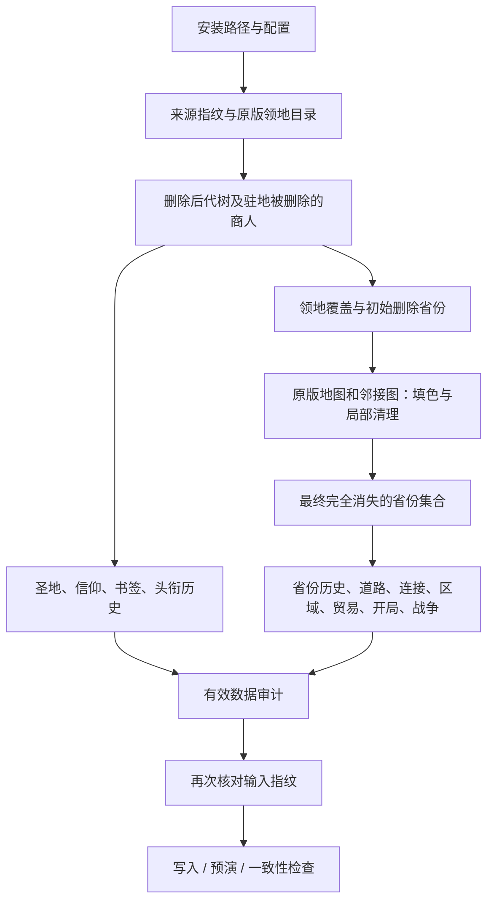

# CK3 Smaller Map

精简《Crusader Kings III》的可玩地图，以减少模拟负担。
[Steam Workshop](https://steamcommunity.com/sharedfiles/filedetails/?id=3488444772)

当前 Mod 为 **1.1.0**，基于 **CK3 1.21.0 / Steam build 26622941** 重建。
保留欧洲、地中海、中东、中亚、东亚、西藏、新疆、北印度等地区；台湾和琉球保留在
努山达拉体系内，首府迁至台湾，保留琉球的名义帝国。具体范围以配置中的头衔 ID 为准。

工具每次读取当前安装的原版数据，生成 Mod 覆盖文件。地图始终从原版
`provinces.png` 重绘，不叠加修改旧 Mod 图片。

## 安装和运行

需要 Python 3.10+、本机 CK3，以及 NumPy、Pillow、SciPy。在仓库根目录执行：

```powershell
python -m pip install -r requirements.txt
python update_mod.py --dry-run
python update_mod.py
python update_mod.py --check
python -m unittest discover -s tests -v
```

Windows 默认从 Steam 注册表位置和 `libraryfolders.vdf` 查找游戏，不保存个人安装路径。
未找到、发现多个安装，或在其他系统运行时，显式指定包含 `common/`、`history/`、
`map_data/` 的 **game 目录**：

```powershell
python update_mod.py --game-path "E:\SteamLibrary\steamapps\common\Crusader Kings III\game" --check
```

| 模式 | 行为 |
| --- | --- |
| 默认 | 完整生成和审计；写入文件、删除清单中的过期文件、更新清单及报告 |
| `--dry-run` | 完整生成和审计，只报告计划，不写入、不删除 |
| `--check` | 完整生成和审计，比较磁盘上的文件；有差异则以非零退出码结束 |

`--dry-run` 与 `--check` 互斥。`--check` 比较完整文本字节、文件清单和每个地图像素，
不只是版本号或图片尺寸。所有模式都把游戏目录作为只读输入。

## 代码结构

`update_mod.py` 仅处理参数、路径选择和错误退出。业务代码位于 `smaller_map/`，
函数显式接收配置和删除集合，不从命令行入口读取全局变量。

| 模块 | 职责 | 何时修改 |
| --- | --- | --- |
| `config.py` | `MapConfig` 和默认删图政策 | 调整区域、接收省份、首府或圣地 ID |
| `pipeline.py` | 按依赖顺序调用各阶段，汇总审计及报告 | 增加一种联动处理的数据 |
| `script.py` | Clausewitz 分词、带位置的语法树、列表／赋值读取、区间编辑 | 脚本语法变化或增加通用编辑能力 |
| `titles.py` | 领地目录、父子关系、商人依赖、领地生成及审计 | 头衔结构或商人驻地规则变化 |
| `terrain.py` | 省份定义、邻接图、颜色接收、局部像素与飞地清理 | 地图结构或填色算法变化 |
| `religion.py` | 圣地、普通／重要圣地列表、信仰和主圣地审计 | 宗教文件结构变化 |
| `history.py` | 书签、领地／省份历史、历史战争 | 历史格式变化 |
| `dependencies.py` | 道路、地图连接、地理／贸易／气候列表、开局效果及审计 | 地图关联数据库变化 |
| `installation.py` | Steam 路径发现、游戏版本、输入指纹 | 安装布局或输入集合变化 |
| `storage.py` | 路径限制、写入、清单、报告、只读／写后共用验证 | 产物管理变化 |
| `common.py` | 统一异常和进度输出 | 通用错误处理变化 |
| `tests/test_update.py` | 合成数据的回归测试 | 修改逻辑时补充实际边界情况 |

旧的 `ck3parser.py`、`ck3titles.py`、`ck3compat.py` 已移入对应模块并删除，不保留转发层。
程序化调用从对应模块导入，不从 `update_mod.py` 导入业务函数。

## 配置

编辑 [`smaller_map/config.py`](smaller_map/config.py) 的 `DEFAULT_CONFIG`。
当前五类规则均在实际使用：

| 字段 | 作用和约束 |
| --- | --- |
| `delete_titles` | 删除头衔及完整后代树，支持 `h_/e_/k_/d_/c_/b_`。不存在的 ID 会报错 |
| `province_receivers` | 已删除区域的颜色接收省份，必须在原图存在、无领地且被原版标为不可通行；本字段不单独选择删除头衔 |
| `capital_replacements` | 旧县 ID → 保留县 ID。只改保留头衔的 `capital` 标量，不改注释、字符串或名字相近的 ID |
| `holy_site_replacements` | 删除圣地 ID → 保留圣地 ID；没有替代规则的删除圣地从信仰列表移除 |
| `faith_fallbacks` | 信仰 ID → 保留圣地 ID；仅在普通和重要圣地全部被移除时补一个 |

东南亚使用不可通行省份 `11215`，北部使用西伯利亚荒原 `1464`。RGB 从当前
`definition.csv` 获取，不需单独配置。商人家族由驻地是否被删除自动推导，无需手动枚举。

可传入独立政策测试另一种删图范围，避免修改全局状态：

```python
from dataclasses import replace
from pathlib import Path
from smaller_map.config import DEFAULT_CONFIG
from smaller_map.pipeline import run

# k_example 只是示例，需替换为当前原版确实存在的头衔。
config = replace(DEFAULT_CONFIG, delete_titles=DEFAULT_CONFIG.delete_titles + ("k_example",))
run(Path(r"E:\SteamLibrary\steamapps\common\Crusader Kings III\game"),
    Path.cwd(), config, dry_run=True)
```

## 数据流与执行顺序



1. 读取版本和输入指纹，解析全部 `common/landed_titles/*.txt`。语法树保留源码位置、
   重复键和注释，不转换成会丢失重复键的字典。
2. 从 `delete_titles` 展开后代树，再递归选中驻地被删除的商人家族。删除对应领地块，
   对保留头衔应用首府修正。整份文件清空时仍输出注释覆盖，防止原版重新生效，
   也避免孤立 `@变量` 被游戏误读为头衔。
3. 用当前 `definition.csv`、`default.map` 和 `provinces.png` 构建省份邻接关系并清理地图。
   返回 `MapResult`：图片、修改像素数、最终删除省份和吸收特殊省份数。
4. 头衔集合驱动圣地、信仰、书签和头衔历史；最终省份集合驱动省份历史、道路及地图连接等。
   保留历史中指向删除头衔的 `liege`、`de_jure_liege` 显式改为 `0`。
5. 审计按“生成覆盖优先，否则读取原版”的有效数据执行。核对保留头衔的父子关系和省份、
   首府与历史引用、圣地非空／无重复／有定义，以及地图关联数据中的删除成员。
6. 再次计算输入指纹；游戏在运行期间更新则中止。通过后才进入输出阶段，写后重新打开
   文本及 PNG，复用同一套完整内容校验。

### 地图算法边界

- 删除范围从头衔推导。颜色规则和原本已有的荒原不会单独授权清理其他地区。
- 地区规则可纳入相连的无头衔土地，但接触保留男爵领的组件和海域受保护。
- 其他删除区域选择邻近或可达的不可通行接收省份，同等条件按省份 ID 稳定选择。
- 有限轮次吸收封闭河流、湖泊、荒地，再用像素连通组件清理局部碎片。
  同一省份 ID 在其他地方的分离形状不会一起被删除。
- 邻接图和像素连通都处理东西接缝。保留男爵领、海域、接收者原有像素以及含受保护像素
  的完整组件受保护，并与原图逐像素比较。
- 只有整种省份颜色消失才删除该省份的共享历史和连接；局部填色保留外部形状及数据。

### 其他依赖的处理

道路任一节点被删除时移除**整条原始道路**，包括港口被删的海路。不抽掉中间节点，
避免拼出捷径或要求不存在的 spline 段；其他道路保留原始路径。

地理区域、贸易商品产地、贸易枢纽、岛屿和气候数据只清理对应类型列表，不把颜色或其他
数字当省份。空区域仍保留数据库键供脚本引用。不凭空迁移商品产地。开局效果清理删除
领地／省份作用域及对应历史商人调用。战争目标全被删除则移除战争，否则只清理删除目标
和无效位置。

## 游戏更新后的维护步骤

1. 等 Steam 完成游戏和 DLC 更新，执行 `python update_mod.py --dry-run`。
   即使版本号不变，输入指纹也会反映地图和脚本变化。
2. 出现缺失头衔、无效接收省份、首府或圣地问题时，先查**当前安装的原版文件**，
   再修正 `config.py` 的 ID。不要静默跳过，也不要套用旧省份颜色。
3. 格式变化时修改职责表中的对应模块，再补回归测试。新增输入目录或文件时，同时更新
   `installation.source_snapshot()` 的输入集合；新增处理阶段时，将其接入
   `pipeline.run()` 的生成、有效数据审计和报告统计。
4. 运行测试，正常重建，再运行 `--check`。检查报告中的来源、警告、删除数量和输出哈希。
5. 更新 `CHANGELOG.md`、`workshop.md` 和 `descriptor.mod` 的 Mod 版本；
   `supported_version` 自动由游戏的 `titus_branch.txt` 生成。
6. 完全重启 CK3，新开存档验证地图、保留地区、书签和模拟运行。静态校验不证明实际
   渲染、寻路或运行表现；旧存档不会重新初始化地图。

若 DLC 目录新增 `common/`、`history/`、`map_data/` 覆盖，或压缩包包含这些路径，需适配
有效输入合并。当前生成器读取基础 `game/` 数据，不自动合并 DLC 脚本覆盖。本机
Silk and Silver 独立目录目前仅有声明、加载画面和音频资源，地图与商贸脚本位于基础目录；
该次检查证据见 `validation/dlc-audit.json`。

## 产物与验证

| 路径 | 用途 |
| --- | --- |
| `3488444772/` | 实际 Mod 内容，仅覆盖受影响的原版相对路径，`thumbnail.png` 独立保留 |
| `.smaller_map_generated.json` | 受管理文件清单，用于清理过期产物 |
| `.smaller_map_report.json` | 当前来源指纹、配置、审计统计、各输出 SHA-256 |
| `validation/` | 历史检查证据，不参与生成 |
| `CHANGELOG.md` / `workshop.md` | 版本记录和工坊文案 |

输出固定在仓库内的 `3488444772/`。任何写入或删除前先验证全部清单路径不能越界，
输入与输出不能重叠，清单之外的文件不清理。工具不向本机工坊目录同步，也不提交、推送
或发布到 Steam。

14 项回归测试覆盖解析与错误输入、首府替换边界、独立配置、商人依赖、道路、类型列表、
嵌套／点号作用域、历史战争、东西接缝、像素差异、Steam 库发现、只读模式、过期文件和
路径越界。原版两处重复教会头衔及 17 个圣地少于三处的信仰已在报告中记录，所有保留
信仰至少有一个圣地。

## 致谢

受到 [Starmender](https://steamcommunity.com/id/starmender) 的
[Smaller World Map](https://steamcommunity.com/sharedfiles/filedetails/?id=2882223898) 启发。
